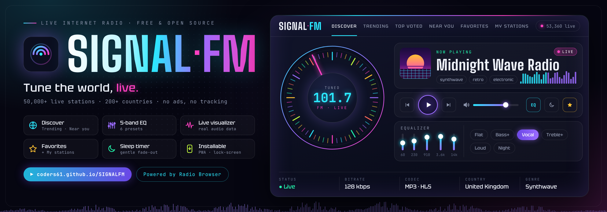
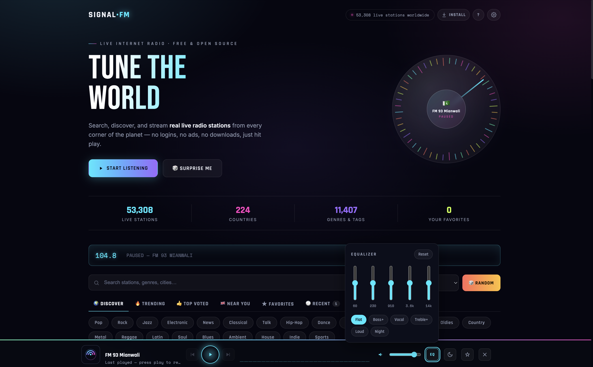

<p align="center"></p>

<p align="center">
  A free, open-source web radio app. Stream <b>50,000+ live radio stations</b> from <b>200+ countries</b> right in your browser.<br>
  No account, no ads, no tracking. Install it as an app if you like.
</p>

<p align="center">
  <a href="https://coders61.github.io/SIGNALFM/"></a>
</p>

<p align="center">
  <a href="https://github.com/coders61/SIGNALFM/stargazers"></a>
  <a href="LICENSE"></a>
  
  
</p>

<p align="center">
  
</p>

---

## 📑 Contents

- [What's new](#-whats-new)
- [Features](#-features)
- [Add your own station](#-add-your-own-station)
- [Install it as an app](#-install-it-as-an-app)
- [Keyboard shortcuts](#️-keyboard-shortcuts)
- [Run it yourself](#-run-it-yourself)
- [Project structure](#-project-structure)
- [How it works](#-how-it-works)
- [Troubleshooting](#-troubleshooting)
- [Roadmap](#-roadmap)
- [Contributing](#-contributing)
- [License](#-license)

---

## 🆕 What's new

**v2.1: My stations**
- Add any radio stream yourself, even ones that aren't in the directory
- Test a link before saving it, then edit or delete it any time
- Paste a stream link into the search box to add it instantly
- Export / import now backs up your own stations too

**v2.0: The big upgrade**
- Trending, Top voted and Near you charts, 24 genres and sorting
- 5-band EQ, real audio visualizer, sleep timer, auto-reconnect
- Saved favorites, history, share links, dark/light themes
- Installable as an app, with lock-screen controls and keyboard shortcuts

---

## ✨ Features

### 🌍 Discover
- Browse **200+ countries**, or jump straight to one from the dropdown
- 🔥 **Trending** and 👍 **Top voted** charts, updated live
- 📍 **Near you**: popular stations in your country
- 🎧 **24 one-tap genres** (Jazz, Lo-Fi, Hip-Hop, News, Classical, …)
- 🔍 **Smart search** across station names *and* genres
- ↕️ Sort by popularity, trending, votes, quality or name
- 🎲 **Surprise me**: finds a random station that is actually live

### 🎧 Listen
- Reliable playback with automatic fallback between stream modes
- 📡 **HLS** (`.m3u8`) stream support
- 🔁 **Auto-reconnect** when a stream drops
- 🎚️ **5-band equalizer** with presets: Bass+, Vocal, Treble+, Loud, Night
- 📊 **Real audio visualizer**, driven by the live audio when the station allows it
- ⏾ **Sleep timer** with a gentle fade-out
- ⏮ ⏭ Next / previous station
- 🔒 **Lock-screen & media-key controls**
- ⌨️ **Keyboard shortcuts** (press <kbd>?</kbd> in the app)

### ⭐ Your library
- **Favorites saved permanently** in your browser
- 🕘 **Recently played** history
- 📻 **My stations**: add any radio stream link yourself (MP3, AAC, OGG, HLS, or `.pls`/`.m3u` playlists), test it, then edit or delete it later
- ⬇⬆ **Export / import your library** (favorites + your own stations) as a JSON file to move it between devices
- ↗ **Share links** to any station (`…/#station=<id>`)
- 👍 **Vote** for stations you love
- Remembers your last station, volume, EQ and theme

### 📱 App
- 🌗 **Dark, light & auto** themes
- 📲 **Installable** on phone and desktop (PWA)
- Fully responsive and accessible (keyboard & screen-reader friendly)
- ⚡ No frameworks, no build step, no backend: just HTML, CSS and JavaScript

---

## 📻 Add your own station

Can't find a station? If you have its stream link, you can add it yourself.

1. Open the **📻 My stations** tab and click **＋ Add a station**, or press <kbd>A</kbd>.
   *Shortcut:* paste the link straight into the search box and click **＋ Add as a station**.
2. Paste the **stream link**. The app accepts:
   - direct audio streams (`.mp3`, `.aac`, `.ogg`, …)
   - HLS streams (`.m3u8`)
   - playlist files (`.pls`, `.m3u`), which are read automatically
3. Optionally add a name, a logo link and genres.
4. Click **▶ Test it** to check that it plays, then **Save station**.

Your stations get a **MINE** badge and work like any other station: favorite them, skip through them with next/previous, and control them from the lock screen. To change or remove one, click the **ⓘ** on its card and choose **✎ Edit** or **🗑 Delete**.

> 💡 **Where do I find a stream link?** Many station websites list it under "Listen", "Stream" or "Player". On secure sites such as GitHub Pages, the link must start with `https://`.

---

## 📲 Install it as an app

SIGNAL•FM can be installed like a normal app, with its own icon and window.

| Device | How |
| --- | --- |
| **Chrome / Edge (desktop)** | Click **Install** in the top bar of the app, or the install icon in the address bar |
| **Android (Chrome)** | Menu **⋮** → **Add to Home screen** / **Install app** |
| **iPhone / iPad (Safari)** | **Share** button → **Add to Home Screen** |

---

## ⌨️ Keyboard shortcuts

| Key | Action |
| --- | --- |
| <kbd>Space</kbd> / <kbd>K</kbd> | Play / pause |
| <kbd>N</kbd> / <kbd>P</kbd> | Next / previous station |
| <kbd>R</kbd> | Random station |
| <kbd>M</kbd> | Mute / unmute |
| <kbd>Shift</kbd> + <kbd>↑</kbd> / <kbd>↓</kbd> | Volume up / down |
| <kbd>F</kbd> | Favorite the current station |
| <kbd>I</kbd> | Station info |
| <kbd>E</kbd> | Equalizer |
| <kbd>S</kbd> | Cycle the sleep timer |
| <kbd>/</kbd> | Search |
| <kbd>A</kbd> | Add your own station |
| <kbd>Esc</kbd> | Close panels |

---

## 🚀 Run it yourself

It's a static site, so any web server works:

```bash
git clone https://github.com/coders61/SIGNALFM.git
cd SIGNALFM
python3 -m http.server 8000
```

Then open **http://localhost:8000**.

> Double-clicking `index.html` also works, but the install-as-app and offline features need a web server.

### Host your own copy on GitHub Pages (free)

1. **Fork** this repository.
2. In your fork, go to **Settings → Pages**.
3. Under **Source**, choose **Deploy from a branch**, then `main` and `/ (root)`, and click **Save**.
4. After a minute or two your radio is live at `https://<your-username>.github.io/SIGNALFM/`.

---

## 📂 Project structure

```
SIGNALFM/
├── index.html            # page layout
├── css/style.css         # all styles (dark + light themes)
├── js/app.js             # all app logic
├── sw.js                 # service worker (offline app shell)
├── manifest.webmanifest  # app name, icon and colors for installing
├── icons/icon.svg        # app icon
├── banner.png            # banner at the top of this README
├── social-preview.png    # thumbnail for GitHub social preview
├── photo.png             # screenshot used in this README
├── .nojekyll             # tells GitHub Pages to serve files as-is
└── LICENSE               # CC0 1.0
```

> 💡 After changing any file, bump `VERSION` in `sw.js` (e.g. `signalfm-v2.0.1`) so people who installed the app get the update.

---

## 🧠 How it works

- **Station directory:** [Radio Browser](https://www.radio-browser.info/), a free, community-maintained database of radio stations. The app finds the live API servers and switches automatically if one is down.
- **Playback:** each stream is first tried through the Web Audio API, which powers the EQ and real visualizer. If the station doesn't allow that (a browser security rule called CORS), it falls back to normal playback, so the station still plays.
- **HTTPS:** browsers block insecure `http://` audio on secure sites like GitHub Pages. With **Secure streams only** on (the default), those stations are hidden so you don't hit dead ends.
- **Your own stations:** saved alongside your favorites. They never touch the shared directory, so only you can see them.
- **Privacy:** favorites, your own stations, history and settings are stored only in your browser (`localStorage`). There are no accounts, analytics or cookies.

---

## 🛠 Troubleshooting

| Problem | Try this |
| --- | --- |
| A station won't play | Some streams go offline; pick another one, or press **N** for the next station. |
| I can't find a station I know | Open **⚙ Settings** and turn off **Secure streams only**. It may only offer an `http://` stream. |
| The EQ doesn't change the sound | That station doesn't allow audio processing. The EQ panel tells you when this happens. |
| Audio stops when my iPhone locks | Make sure **Enhanced audio** is off in Settings (it's off by default on iPhone/iPad). |
| I don't see new changes after an update | Refresh the page twice, or close and reopen the installed app. |
| My favorites are gone on another device | Your library is saved per browser. Use **Export library** in Settings, then **Import library** on the other device. |
| My own station won't play | Use **Test it** in the add-station form. The link must be a direct audio stream, and on secure sites like GitHub Pages it must start with `https://`. |
| A station I want isn't in the directory | Open the **📻 My stations** tab and add its stream link, or just paste the link into the search box. |

### Known limitations
- **Song titles** (what's playing right now) can't be read from radio streams in a browser without a separate proxy server.
- Station logos, names and stream quality come from the Radio Browser community and are sometimes missing or out of date.

---

## 🛣 Roadmap

### ✅ Done
- ✅ Saved favorites & recently played
- ✅ Trending & top-voted charts
- ✅ Light theme
- ✅ Installable app (PWA)
- ✅ Sleep timer, 5-band EQ, keyboard shortcuts
- ✅ Share links & favorites export/import
- ✅ Add your own custom stream URLs

### 🔜 Coming next
- 🔜 Multi-language interface
- 🔜 World map browsing
- 🔜 Now-playing song titles (needs an optional proxy server)
- 🔜 Cloud sync for favorites across devices

Have an idea? [Open an issue](https://github.com/coders61/SIGNALFM/issues)!

---

## 🤝 Contributing

Contributions are very welcome: bug reports, feature ideas, translations and pull requests.

1. Fork the repo and create a branch: `git checkout -b my-feature`
2. Make your changes. It's plain HTML/CSS/JS, with no build step or installs.
3. Test locally with `python3 -m http.server`
4. Open a pull request describing what you changed and why

Found a bug? Please [open an issue](https://github.com/coders61/SIGNALFM/issues) and include your browser, device, and the station name.

### ⭐ Like it?
**Give SIGNAL•FM a star on GitHub.** It helps more people find it!

---

## 📜 License

Released into the public domain under [CC0 1.0 Universal](LICENSE). Use it, change it and share it however you like.

Radio streams and station logos belong to their respective broadcasters.

## ❤️ Acknowledgements

- [Radio Browser](https://www.radio-browser.info/) and its community, for the free station directory
- [hls.js](https://github.com/video-dev/hls.js), for HLS playback
- [Shields.io](https://shields.io/), for the badges
- Radio stations around the world, for broadcasting

---

<p align="center">
  <b>📻 SIGNAL • FM</b><br>
  <i>"Every station tells a story. Every frequency connects the world."</i>
</p>
